# Trip Draft - Conversation Flow Diagram

Status: Designed (no chatbot UI has been built or verified).

```mermaid
flowchart TD
  START([Start]) --> GREET[Greeting and short explanation of Trip Draft]
  GREET --> QR{Quick reply}
  QR -->|See an example| EX[Show example labelled MOCK DATA]
  EX --> QR
  QR -->|How does this work| HOW[Explain Draft, Proposed, Confirmed and the controls]
  HOW --> QR
  QR -->|Plan a trip| COLLECT[Collect destination, duration, budget EGP, interests]
  COLLECT --> CHECK{Complete and valid}
  CHECK -->|Missing or ambiguous| CLARIFY[Ask one clarifying question with choices]
  CLARIFY --> COLLECT
  CHECK -->|Invalid budget or duration| ERRVAL[Explain problem and suggest a valid range]
  ERRVAL --> COLLECT
  CHECK -->|OK| SUMMARY{User confirms the bot interpretation}
  SUMMARY -->|No, correct it| COLLECT
  SUMMARY -->|Yes| FILTER[Filter dataset by user constraints]
  FILTER --> FOUND{Matching records}
  FOUND -->|None| ERRNONE[Explain no match and offer to relax budget, days or interests]
  ERRNONE --> COLLECT
  FOUND -->|Some| MODELOK{Model available}
  MODELOK -->|No or timeout| ERRAPI[Explain model unavailable, no technical details]
  ERRAPI --> FORM[Rule-based or form fallback: browse valid dataset options]
  MODELOK -->|Yes| CALL[Send filtered records to model, request structured output]
  CALL --> VALID{Backend validates IDs and prices}
  VALID -->|Invalid response| ERRMODEL[Reject output, explain, offer retry or fallback]
  ERRMODEL --> FORM
  ERRMODEL -->|Retry| CALL
  VALID -->|Valid| DRAFT[Show DRAFT itinerary with prices and source info if available]
  FORM --> DRAFT
  DRAFT --> ACT{User chooses an action}
  ACT -->|Accept| ACCEPT[Mark item accepted, left unchanged unless user edits]
  ACCEPT --> ACT
  ACT -->|Reject| REJECT[Item not added, offer alternatives from filtered data]
  REJECT --> ACT
  ACT -->|Swap| SWAP[Show valid alternatives, user picks one]
  ACT -->|Remove| REMOVE[Select item to remove]
  SWAP --> PREVIEW[PREVIEW: before vs after, cost change, label Proposed modification]
  REMOVE --> PREVIEW
  PREVIEW --> APPLY{Apply changes}
  APPLY -->|Apply| APPLIED[Apply and log event for undo]
  APPLY -->|Keep previous plan| KEEP[Discard proposal, plan unchanged]
  APPLIED --> ACT
  KEEP --> ACT
  ACT -->|Undo or Redo| UNDO[Restore state from event history]
  UNDO --> ACT
  ACT -->|Unsupported action or failed update| ERRACT[Explain briefly, plan unchanged, suggest next step]
  ERRACT --> ACT
  ACT -->|Need help| HELP{Human contact configured}
  HELP -->|Yes| CONTACT[Show configured contact channel]
  HELP -->|No| PLANNED[Say human handover is a planned feature, continue with form or chat]
  CONTACT --> ACT
  PLANNED --> ACT
  ACT -->|Finish| CONFIRM{Confirm final itinerary}
  CONFIRM -->|Not yet| ACT
  CONFIRM -->|Confirm| FINAL[CONFIRMED plan: final summary]
  FINAL --> END([End])
```

## Explanation

The main path runs from quick replies to constraint collection, interpretation confirmation, filtering, model request, validation, and a Draft itinerary. Control sits with the user at four points: confirming the interpretation, choosing among actions, previewing then applying or keeping the previous plan, and confirming the final plan. Every error path returns to a recoverable state. If the model fails or its output is invalid, the user continues through the rule-based/form fallback using only validated dataset options. Human handover is shown only as a configured channel or a clearly labelled planned feature.
