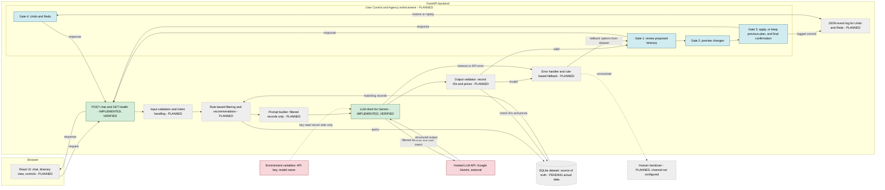

# Trip Draft - System Architecture Diagram

Status: Proposed architecture. Only the `/chat` and `/health` endpoints and the Gemini client are implemented and verified (Week 5 backend demo). All other components are planned.

## Explanation

The React UI talks only to the FastAPI backend; there is no frontend-to-LLM connection, and the API key is read from environment variables on the server. The backend filters the SQLite dataset first and sends only those records to the model. Model output must be structured and is validated against the dataset; invalid IDs or prices are rejected and routed to error handling and the rule-based fallback. Valid results pass through the User Control and Agency gates (review, preview, apply or keep previous plan, final confirmation, and reversible Undo/Redo backed by the event log). Green nodes are implemented and verified, grey nodes are planned, and red nodes are external or configuration dependencies.
